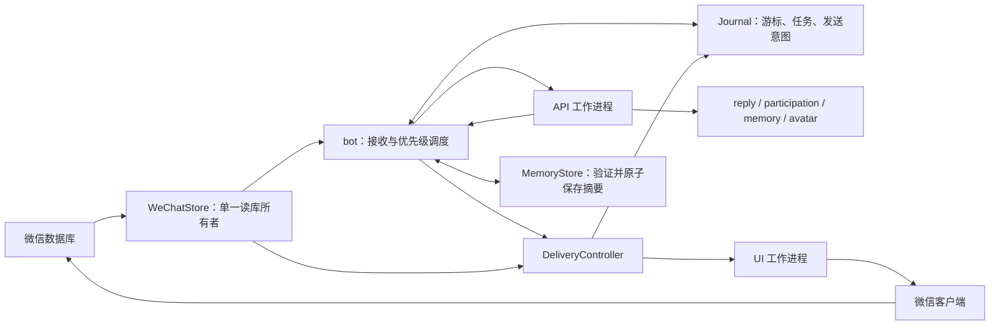

# 架构与故障边界

主进程统一读取微信数据库、刷新解密副本和提交队列事务。模型及界面工作进程只接收快照，不自行读库。队列、模型角色和发送状态分别管理，真实 @ 不依赖主动参与判断。

## 职责与接口

| 入口 | 边界 |
| --- | --- |
| `app/bot.py` | 接收、生成与后台任务调度；发送委托给 delivery |
| `app/delivery.py` | 提交前校验、发送意图、UI 结果及数据库确认；只持有所需依赖 |
| `app/conversation.py` | 确认后的会话变化纯函数；Journal 在确认事务内调用并提交结果 |
| `app/task_policy.py` | 安全错误码与是否可重试的分类 |
| `ai/roles.py` | 从旧配置和 `models` 覆盖解析每个角色的独立设置，不改全局配置 |
| `ai/client.py` | `ModelClient`（兼容名 `DeepSeekClient`）；`request()` 返回 `ModelResult`，包含 message、finish_reason、usage；`complete()` 保持原 message 接口 |
| `storage/journal.py` | 状态持久化、恢复、索引查询和清理；不决定会话接话策略 |
| `app/metrics.py` | 本次运行的阶段耗时、API 用量计数；不保存提示词或内部推理 |
| `storage/relationships.py` | 好感/信任建议校验、场景与来源去重、程序累计熟悉度、短期情绪和自然语言关系描述；不调用模型或写文件 |

队列暂时继续用 JSON 序列化任务，避免一次更换全部历史任务协议；模型结果与错误分类使用独立数据类型。后续可逐步收窄生成和记忆调度的依赖，不需要为此增加服务或消息中间件。

## 两类故障分别处理

生成瞬时失败（网络、超时、HTTP 408/429/5xx）由持久队列等待重试，默认最多两次额外尝试。HTTP 400/401/403、无效响应、上下文构造失败等不盲目重试。HTTP 客户端不再叠加三次本地重试。失败耗尽后生成简短说明，按原顺序等待发送确认；不把失败说明纳入记忆或用它延长参与窗口。真实@接纳时已建立的窗口仍按成员活动独立计时。

UI 已提交或是否提交不明时，保留意图并核对发出记录；没有匹配记录仍暂停发送。这个分支不会套用生成失败策略，不跳过、不盲目补发。确认前失败且明确未提交时才保留原有安全重试。

## 队列升级与长期运行

启动在事务中为旧任务表增加生成列与活跃索引，不改原 JSON，不重置游标。生成列由 SQLite 自动维护，旧版二列 `INSERT VALUES` 仍兼容。只读 `queue-status` 也能读取迁移前的队列，但不执行迁移。

未完成任务查询只解码活跃行；完成记录每分钟裁剪，默认保留200条。仍在等待 UI 结果的完成任务受保护，未决意图和记忆任务不参与清理。独立单调任务序号保证清理后不复用 ID，防止与记忆任务去重键冲突。

主机重启会清空私有内存挂载，行为不变；监听进程重启保留重试次数、等待时间、发送意图与接收游标。

## 诊断与后续优化

`live-status.json` 增加 `build.commit`、有效配置哈希、`metrics.stages` 和 `metrics.models`。分别观察接收、生成调度、UI 结果、发送确认、主动判断和记忆阶段耗时；角色统计包含调用次数、错误次数、API 耗时和可获得的 token 用量。任务还显示重试时间、排队等待与确认耗时。计数仅属于本次监听运行，不当作计费账单；被强制终止的请求可能没有用量结果。

状态变化立即写出；无变化时最多每两秒刷新心跳，减少空轮询写入。后续先根据这些数据确定数据库或 WAL 是否成为瓶颈，再做快照复用和增量处理，发送前补读及版本校验继续保留。

模型角色切换与发布操作见 [配置](CONFIG.md) 和 [部署](DEPLOYMENT.md)。
