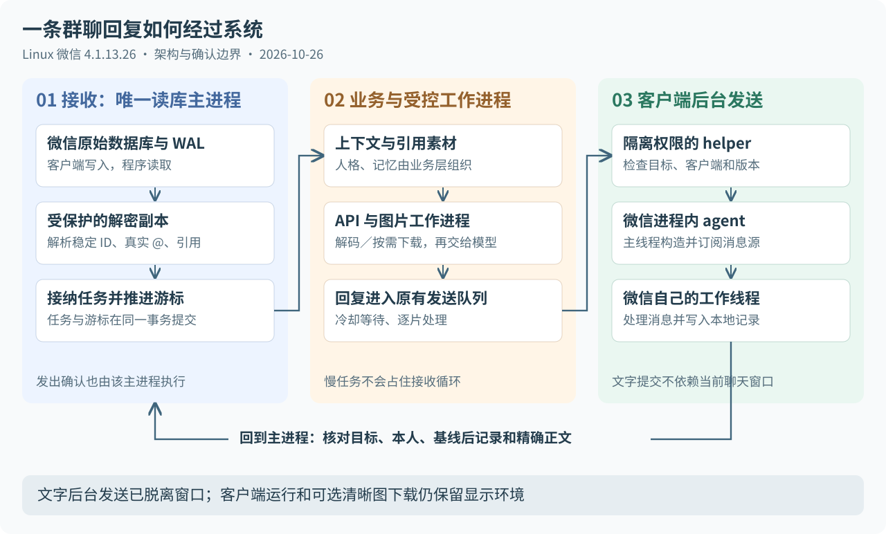

# Linux 微信接入与内部发送链路技术报告

从本地消息读取、桌面自动化，到显式收件人的后台发送与可复用能力库

整理日期：2026-10-26（Asia/Singapore） · 研究记录覆盖：2026-10-19—26 · 代码基线：`c1deadb`

本文面向希望理解原理、参与维护或在其他项目复用微信能力的开发者。先解释为什么这样设计，再给出对象、地址与代码入口。案例中的群名、账号和正文统一省略或使用合成示例。

## 阅读路线

- 先建立全貌：第 1—4 节
- 想学习逆向与 Frida：第 6—9 节
- 排查不触发、发送失败或图片模糊：第 5、10—11 节
- 理解无桌面的实际进度：第 12 节
- 复用代码或继续研究：第 13—16 节

<a id="conclusions"></a>
## 1. 我们已经做到了什么

目前的系统由一个已登录的 Linux 微信客户端提供真实收发能力。程序从客户端本地数据库读取消息，使用模型生成答案，再通过客户端内部的后台服务提交文字消息。它没有自行实现微信网络协议，也没有绕过登录认证。

最重要的发现有五项：

| 发现 | 实际含义 | 验证范围 |
| --- | --- | --- |
| 本地数据库能提供消息、稳定成员 ID、真实 @ 和引用关系 | 不必依靠屏幕 OCR 判断谁说了什么 | 解析实现、离线测试与实际群聊接收 |
| 最初找到的发送入口依赖聊天输入视图 | 有 chat_id，并不等于可以绕过会话选择 | 静态反编译、两轮真实会话切换 |
| 下层后台服务支持消息源中的独立收件人 | 发送文字可以完全不切换当前聊天窗口 | 文件传输助手、群聊及手机确认 |
| 函数返回、点击完成都不等于已经发出 | 必须保留发送意图并核对新增发出记录 | 故障复现、重启恢复测试、实际发送 |
| 手机上的清晰图不等于 Linux 已有清晰缓存 | 读图失败需要沿定位、解码、下载三层排查 | 本地缓存、WXGF 解码与自动下载实测 |

当前后台文字发送已经投入现有机器人使用；微信启动、登录和清晰图片的兼容下载仍保留虚拟显示环境。可复用部分已抽为 `wechat_linux` 0.1.0。

本文对证据作以下区分，后文的“验证成功”都应结合其范围理解：

| 证据类型 | 能回答什么 | 不能替代什么 |
| --- | --- | --- |
| 静态分析 | 某个固定二进制中，字段如何读写、函数如何调用 | 对象此刻是否存在、调用是否可实际成功 |
| 运行时观察 | 当前进程中的对象关系、线程、实际执行路径 | 未观察版本或其他账号场景 |
| 受控发送 | 一条特定请求经过调用、发出记录及必要的手机核对 | 长期稳定性、任意联系人和所有消息类型 |
| 合成回归 | 明确故障条件、状态转换与恢复逻辑是否符合预期 | 真实微信每次都成功、风控风险降低 |

固定样本上的发现和当前工程化实现分别见 [分析摘要](NATIVE_ANALYSIS.md)、[发送接口](NATIVE_API.md) 与 [能力库说明](WECHAT_LIBRARY.md)。

<a id="sample"></a>
## 2. 分析对象、工具与可复现条件

本次分析的客户端是 Linux 微信 **4.1.13.26，x86_64 / amd64**。实验使用的主程序与 Ghidra 样本以同一个 SHA-256 核对：

```text
2749535f299ba67feb8ef80cab898bb0531fa8f376b16f8a72db706811c84132
```

这个值证明各轮研究使用了相同的本地二进制；它本身不构成腾讯官方签名认证。

对应主程序和原始 deb 已保存为 [本地备用资源](../resources/wechat/README.md)，附版本、来源与 SHA-256 清单；deb 内部主程序也已核对为同一 hash。资源不随 Python wheel 或普通源码发布包分发。

| 工具或机制 | 本项目中的用途 |
| --- | --- |
| Ghidra 12.1.4 | 导入 ELF，查看函数、交叉引用、虚表和伪 C；后续针对限定函数反编译 |
| 反汇编与函数边界资料 | 复核参数、字段偏移、尾调用和析构路径，避免只相信反编译器的类型推断 |
| Frida 17.24.3 | 早期短时观察正常调用；后期在进程内执行经核验的原生调用 |
| Python / SQLite | 消息解析、状态事务、独立确认、测试及工程封装 |
| Xvfb、D-Bus、AT-SPI、窗口管理器 | 微信运行与登录、早期桌面发送、当前可选清晰图下载 |
| GLib idle source | 将一次受控操作交给微信正在运行的主事件循环 |

Ghidra 的输出是对机器码的解释，并不能恢复原项目注释、完整类型或官方函数名。本文中的 `prepare`、`batch`、`InputModel_Send` 等均为研究标签或封装名。特别是 C++ 对象、隐藏返回参数和析构行为，需要结合汇编与运行时证据。

本文所有十六进制函数地址默认都是 **RVA，即相对实际模块加载基址的偏移**。本次 Ghidra 工程的显示地址另外包含 `0x100000`，不能直接把显示地址当运行时地址。

```text
运行时函数地址 = 微信主模块本次加载基址 + RVA
本次 Ghidra 显示地址 = RVA + 0x100000
```

即使版本号相同，只要程序 hash 或关键指令指纹不匹配，当前 helper 也应拒绝提交。资源定义见 [profile.json](../wechat_linux/native/profile.json)。

### 从 deb 到候选函数，具体怎样缩小范围

deb 是安装包容器；解开后才能分别看程序、资源和安装元数据。本次真正反编译的是其中的 x86_64 ELF，不是把 deb 直接“还原成原项目源码”。工作按以下顺序推进：

1. **固定输入。** 核对包架构、主程序 ELF 架构和 hash，使本机静态样本与服务器运行程序一致。
2. **找线索，而不是通读整个二进制。** 使用字符串、Qt 元数据、日志或类型资料缩小候选。字符串出现只能说明存在这个数据，还要寻找使用它的代码。
3. **复核交叉引用。** 本地静态工具按 ELF 的加载段在文件偏移与程序地址间转换，寻找 RIP 相对 LEA 引用，并用反汇编器核对指令。该扫描只覆盖一种直接引用模式，不代表找到了全部调用者。
4. **限定函数边界再反编译。** 利用本样本的 `.eh_frame_hdr` 信息辅助确定范围，交给 Ghidra 生成限定函数的伪 C；关键字段、参数和析构再回看汇编。研究脚本以只读、不保存项目改动的方式运行，未把临时类型推断写回微信程序。
5. **让正常行为提供证据。** 早期以本账号文件助手的固定测试标记观察正常桌面发送，在候选 dispatch 处记录线程、容器、虚表和标记字段偏移。没有把任意指针或所有群消息正文导出。
6. **再做最小原生调用。** 先只构造和释放，核对对象字段与引用关系；能解释生命周期之后，才进入明确授权的一次发送与独立确认。

这种方法把“看上去像发送函数”逐渐变成“在固定样本和具体场景中被证实的入口”。即使反编译器给函数起了一个很像正确答案的名字，也不能省略后面的验证。

<a id="timeline"></a>
## 3. 研究是怎样一步步推进的

| 时间 | 阶段 | 取得的结果与边界 |
| --- | --- | --- |
| 10 月 19 日 | 准备 x86_64 分析样本与 Ghidra | 主程序导入、反编译器及样本身份核对；没有据此宣称完成全程序还原 |
| 10 月 20 日 | 桌面发送、持久队列和引用处理 | 发现冷却丢触发、发送检查失效等问题；建立发送意图与发出确认 |
| 10 月 20 日 | WXGF 图片解码 | 识别彩色 HEVC 流与单色遮罩，取得真实清晰缓存图 |
| 10 月 24 日 | 第一次内部发送 | 主线程构造消息源，调用输入视图背后的控制器；仍需先选目标会话 |
| 10 月 24—25 日 | 对象复用与后台服务分析 | 证明输入控制器跟随视图复用；找到账号服务注册表与惰性批次任务 |
| 10 月 25 日 | 显式收件人的后台发送 | 窗口停在另一个会话时，分别向文件助手、测试群发出；群测试手机确认只有一条 |
| 10 月 25 日 | 正式替换提交后端 | 现有队列接入 `native_service`，普通真实 @ 回复实际通过 |
| 10 月 25—26 日 | 桌面精简与图片问题复查 | 文字可在精简会话中收发；清晰图下载仍需恢复相应桌面能力 |
| 10 月 26 日 | 自动获取清晰缓存、能力库提取 | 图片受控自动下载通过；公共库、兼容入口和 Linux 集成通过回归 |

这些阶段解决的是不同问题。“内部函数调用成功”“不切换窗口发送成功”“服务上线成功”和“完全取消显示环境”不能合并成同一个结论。

<a id="architecture"></a>
## 4. 当前系统的整体工作方式



接收和发送走两条不同路线。

接收时，微信先把消息同步到自己的数据库；机器人主进程维护受保护的解密副本，解析消息并接纳任务。发送时，队列保存意图，发送工作进程把目标和正文交给隔离 helper，由进程内脚本构造后台发送任务。最终仍由主进程读库确认。

模型并不直接控制微信。它产生回复文本，或根据明确引用获得图片输入；微信对象、窗口、指针、权限、发送确认和重试规则由程序处理。

### 为什么主进程独占读库

数据库读取可能包括更新解密副本和回放 WAL，不是单纯对一个永远不变的 SQLite 文件做 SELECT。如果几个进程同时刷新同一副本，就可能互相覆盖或读到不一致的中间状态。

因此当前约束是：**一个账号的共享解密目录只有一个读库所有者**。主进程查询消息、引用和附件索引；模型与图片工作进程只收到已经核验的文本或本地文件绑定，不反向打开微信数据库。

公共库会话使用同一 `decrypted_dir/.listener.lock`，现有机器人也使用该锁。不能为同一账号再建一套解密目录来绕过所有者约定。[锁实现](../wechat_linux/runtime/locking.py) · [会话接口](../wechat_linux/session.py)

### 为什么采用受控工作进程

慢 API、桌面等待、解码或原生提交都可能耗时。把它们放到受控子进程，主进程就能继续接收、调度与核对结果；在本地任务被取消或超时时，也可以结束对应工作进程。

结束本地 API 进程不等于取消服务端请求；结束原生调用进程也不等于证明消息未发出。任务取消和发送幂等必须分别处理。

<a id="database"></a>
## 5. 消息读取：为什么能知道谁说话、谁被 @、引用了什么

### 5.1 读取的是本地客户端数据

当前实现读取本账号的联系人、会话和消息数据库，必要时刷新受保护的解密副本。消息库可以分片；目标会话的表按内部 chat_id 对应，查询结果统一合并和排序。

这条路线不需要每次截屏读聊天气泡，也不依赖群友昵称的位置。它仍受客户端同步行为限制：**客户端没有同步到本地的事件，解析器无法凭空读出。** 拍一拍就是曾经遇到这一边界的例子。

### 5.2 数据库加密与 WAL 要一起处理

当前适配的数据库使用 SQLCipher 风格的加密页。实现中页大小为 4096 字节，页尾保留区为 80 字节，涉及 AES-CBC、IV、HMAC 和页号。已有派生密钥由受权限约束的扫描流程取得，并通过页面校验确认；不是把任意看起来像密钥的内存片段直接当成有效密钥。

密钥扫描与发送注入是两个用途不同的机制。扫描用于取得本账号数据库的读取材料；Frida 发送 helper 不读微信数据库，也不把这些密钥传给模型。

近期写入可能在 WAL 中，还没有合并回主数据库。只解密主文件可能看到旧消息。现有实现识别当前 WAL 周期，只回放最后一次有效提交之前的完整帧；合并前校验加密页 HMAC，未提交尾部不作为已提交数据使用。相关实现和故障回归见 [crypto.py](../wechat_linux/storage/crypto.py)、[加密测试](../tests/test_crypto.py)。

这里要区分两种“保存”：微信自己的原始数据库由客户端管理；本程序的解密副本、数据库密钥和待处理队列置于私有 `tmpfs,noswap`。程序没有把全部明文聊天库打包进项目。

### 5.3 稳定 ID 与昵称各司其职

成员的内部 `user_name`（常见形式为 wxid）用于身份绑定，昵称仅用于显示。长期记忆进一步按“机器人账号＋群 ID＋成员稳定 ID”隔离，改名不会重建成另一个人，同名也不会合并。

模型输入中的 U1、U2 是当轮临时标签，不是微信 ID，也不是群人数。跨轮继续用 U1 指代同一个人是不可靠的；旧摘要缺少当轮映射时，需要隔离歧义，而不是拿今天的 U1 映射改写昨天的记忆。详见 [身份与临时编号](MEMORY_IDENTITY.md)。

### 5.4 真实 @ 来自元数据

普通文本消息会解析 `atuserlist` 等来源元数据，用其中的稳定账号 ID 判断是否真正 @ 机器人。手打 `@ds` 可以只是普通文字。

两个状态必须保留区别：

| 解析值 | 含义 |
| --- | --- |
| `mentioned_users=[]` | 当前解析结果明确没有列出的 @ 对象 |
| `mentioned_users=None` | 缺少或无法解析这类元数据，不能当成可靠的“没有 @” |

群聊中的 ds 关键词是另一个产品触发规则，不应与真实 @ 混写成一种判断。[元数据解析](../wechat_linux/storage/store.py) · [机器人触发入口](../wxbridge/app/bot.py)

### 5.5 引用消息的外层类型可能不是普通文本

曾出现“引用图片后喊 ds 不触发”，其中一种已确认原因是消息类型过滤：微信可以把引用回复编码为 64 位组合类型，例如 `0x3900000031`，低位主类型为 49，高位子类型为 57。旧逻辑只接受类型 1，便会跳过带真实 @ 的引用回复。

引用消息中，`appmsg/title` 是本次新写的问题，`refermsg` 承载被引用内容、作者和原时间。这两部分需要分开：旧引用里的 @ 不能冒充本次真实 @；引用中的“这”也不能靠最近一张图片或其他群的内容来猜。

普通上下文按当前窗口取值；用户明确引用的旧消息可早于该窗口，作为独立引用快照传入。读取范围不因此扩展成整个群历史。[引用解析](../wechat_linux/messages/references.py) · [引用功能说明](REFERENCES.md)

### 5.6 轮询速度不等于端到端回复速度

当前配置默认每 2 秒查询新消息，调度循环可按不超过 1 秒的节拍处理工作结果，消息查询另行限流。发送前补读仍由主进程执行，用于刷新入站状态、确认水位和待发送任务是否仍有效；不会因此额外请求一次模型。

端到端耗时还包括客户端同步、查询、模型排队与生成、冷却、提交和数据库确认。不能把“2 秒轮询”写成“2 秒内必回”，也不能只按轮询次数推算整机功耗。[运行循环](../wxbridge/app/bot.py)

<a id="desktop-failures"></a>
## 6. 桌面发送阶段：几个失败为什么值得保留下来

最初用 AT-SPI 和鼠标操作客户端，路径直观，但它同时受界面状态、草稿、焦点、窗口和动作语义影响。下面的故障推动我们把“执行操作”和“确认结果”拆开。

| 现象 | 已确认原因或缺陷 | 采用的处理 |
| --- | --- | --- |
| 冷却期间 @ 没有回复，之后又恢复 | 先推进游标，再因冷却跳过，触发不再被补处理 | 有效任务入队，冷却变为等待 |
| 生成了 41 字回复，却没有匹配发出记录 | 发送后 GI Text 调用异常被吞掉；残留草稿随后挡住其他回复 | 修正接口、移除吞异常分支，改用持久意图和精确发出确认 |
| 新策略声称执行了发送动作，草稿却不变 | 该版本按钮的第 0 个 AT-SPI 动作是 `SetFocus`，并非 click | 按动作名称识别；仅聚焦不能被视为点击或发送 |
| 鼠标已经在目标点，仍出现等待超时 | `mousemove --sync` 等待未发生的新移动事件 | 移除这类同步等待，直接核验实际位置与窗口命中 |

**41 字旧草稿第一次为什么没有发出，未取得足以隔离原因的事件级证据。** 后来确认的 SetFocus 错误是后续策略中的具体问题，不能反向写成最早那次失败的确定根因。

旧草稿按当时明确授权清理，未补发。后续来源不明的不同草稿继续受保护。当前 `native_service` 文本发送不再使用输入框，因此草稿不会成为该后台路径的依赖。

这些故障还有一个共同点：模型往往已经生成完成，卡住的是后半段发送。排障时要分别记录“接纳、生成完成、提交、确认”，否则很容易把所有无回复都归给 API 慢。

<a id="first-native"></a>
## 7. 第一次内部发送：为什么找到函数后还要选会话

### 7.1 我们先找到了哪一层

第一条实际可用的原生入口，是聊天输入视图背后的发送控制器。其已验证入口 RVA 为 `0x497d4c0`，研究阶段可概括为：

```text
Send(发送控制器, action=3, 消息列表)
```

它没有独立 chat_id 参数。控制器会回到自己绑定的输入视图，再从视图读取当前目标。因此早期实验虽然不输入正文、不点发送按钮，仍需先把界面选到文件传输助手。

原生函数调用成功解决了“如何提交正文”，还没有解决“如何独立指定收件人”。

### 7.2 两轮切换推翻了“每群缓存一个模型”的猜想

静态分析显示，视图 `+0x228` 保存控制器，控制器 `+0x10` 回指视图。我们随后对正常会话切换做了两轮短时跟踪，仅观察，不写字段、不主动调用发送。

下表中的 O1/O2/O3 只是实验内的匿名对象编号：

| 阶段 | 输入视图 | 发送控制器 | 关联对象 | 当前目标 |
| --- | --- | --- | --- | --- |
| 初始 | O1 | O2 | O3 | 测试群 |
| 切到文件助手 | O1 | O2 | O3 | 文件助手 |
| 切回 | O1 | O2 | O3 | 测试群 |
| 再切到文件助手 | O1 | O2 | O3 | 文件助手 |
| 再切回 | O1 | O2 | O3 | 测试群 |

对象保持复用，变化的是视图的目标字段。缓存 O2 只会得到一个继续跟随界面目标的控制器，并不能固定收件人。此观察只覆盖该已登录页面，不能外推成所有页面、窗口和进程生命周期都只有一份实例。

### 7.3 为什么不能只改 chat_id 字符串

正常切换入口 `0x4957c00` 除了更新视图 `+0x250` 的目标，还处理草稿、编辑器关联和附件状态。直接改一个字符串会让其它状态仍指向旧会话。

研究中没有找到已验证的 `get_model(chat_id)` 通用入口。对象也不是因为“整个被加密”才难找：已观察到的指针、容器和 chat_id 可以读取，真正难点是类型识别、正确所属层、线程及生命周期。


<a id="backend"></a>
## 8. 后台服务：如何做到明确指定收件人

### 8.1 从聊天视图转向账号服务

沿正常发送链路向下分析后，发现当前账号的服务注册表可以从全局内核定位：

```text
微信模块基址 + 0xacf6710 → 全局内核
    内核 + 0x68         → 当前账号上下文
    账号上下文 + 0x18   → 服务注册表
        已存在节点      → 元数据服务、批次任务服务
```

当前实现每次请求重新读取注册表，检查数量边界、链表循环和类型唯一性，再按已核对虚表识别服务；它不长期保存上轮进程的裸指针，也不逐条发送扫描大块堆内存寻找聊天视图。

早期运行时观察到注册表类型标识是 32 字节不透明值；不能只搜索一个想象中的 `MessageManager` 名称。正式实现采用已核对的虚表位置识别对应服务。

### 8.2 收件人属于新建消息源

关键发现是：下层发送需要的目标可以放在**本次新建的消息源**里，而不必来自当前输入视图。

| 结构位置 | 当前样本中核对的含义 |
| --- | --- |
| 控制块总分配 `0x610` 字节、源对象在其后偏移 24 | 客户端构造的共享对象及生命周期结构 |
| `source + 0x90` | 独立收件人字符串 |
| `source + 0xe4` | 消息类型；本次文字为 1 |
| `source + 0x580` | 客户端构造的消息 UUID 字符串 |
| `source + 0x5c8` | UTF-8 正文字符串 |

这里的字符串是客户端 C++ ABI 下的对象，不能替换成 Python 字符串地址或随便写入一个 `char*`。新消息源由客户端构造函数初始化，使用其字符串函数写入；随后读回目标、正文、UUID，核对虚表与批次源列表。

Qt 的列表和 C++ 的 vector 也不能因为都像“三个指针”就互换。早期输入模型路线与当前服务路线使用的容器，需要按各自调用点核对。

### 8.3 构造任务不等于启动发送

批次构造入口 `0x7067550` 返回一个惰性任务。可以先创建任务、检查内容，再释放，而没有发生发送。真正启动需要通过订阅入口 `0x4709f00` 进入微信原有任务系统。

```text
新建消息源：收件人＋正文＋类型＋UUID
    → 元数据准备
    → 构造惰性批次任务       此时尚未发送
    → 订阅任务               从这里开始按未知提交风险处理
    → 微信原有调度与工作线程
    → 核心处理及本地发出记录
```

`0x7129c50` 早期曾被临时标成类似“发送服务”的名字，后续复核显示它更接近发送前元数据处理，不能单独当成发送入口。函数名称必须跟着证据修正。

### 8.4 为什么要交给正确线程和正确的生命周期

构造、准备与订阅通过 GLib 单次 idle 回调交给微信主线程；实际受控实验中，下层核心处理随后在微信原有工作线程出现。我们没有直接从 Frida RPC 线程跳进核心发送函数。

任务要继续持有其消息源。调用结束后还需要匹配的订阅句柄销毁、callable 释放和 shared_ptr 释放。遗漏会泄漏，提前释放则可能让异步任务访问失效内存。异步诊断用的 SourceLocation 也使用能活到脚本脱离之后的固定模块地址，避免借出短命 JS 字符串。

### 8.5 怎样证明真的没有切换会话

受控验证分两步进行，构造预检和真正提交分开：

1. 界面停在测试群，后台把新消息的目标设为文件传输助手；获得新增本人、精确正文和非零服务端消息 ID。
2. 界面停在文件传输助手，后台把目标设为测试群；新增发出记录核对通过，用户手机确认收到且只有一条。

实验注入期间，已识别的正常会话切换入口计数均为零，前后选中目标保持一致。实验前用于准备可观察界面的操作不计入“注入后零切换”，不能把整个维护窗口冒称完全没有任何 UI 准备。

后续正式后端切换，又通过现有队列完成文件助手请求和一次真实 @ 回复。生产实现不再选会话、读输入框或寻找聊天视图。相关当前代码见 [agent.js](../wechat_linux/native/agent.js)。

<a id="frida"></a>
## 9. agent.js 究竟是怎样进入微信的

这里有三个执行位置，不能混在一起：

| 执行位置 | 运行内容 | 角色 |
| --- | --- | --- |
| 微信进程外，普通用户进程 | 机器人、`NativeClient`、发送工作进程 | 决定目标、保存意图、发本机请求 |
| 微信进程外，隔离权限 helper | Python 与 Frida bindings | 验证账号进程、版本、允许清单，建立短时附加 |
| 微信进程内 | Frida 原生组件提供的 JS 运行时和 `agent.js` | 读对象、排主线程回调、调用原生函数 |

微信不是自己打开项目中的 JS 文件。过程是 Python 读取源码，把请求数据和 profile 作为 JSON 常量放在脚本前面，再把整段源码字符串交给 Frida：

```python
# 用于解释执行边界的简化代码，省略权限、版本和异常检查
session = frida.get_local_device().attach(pid)
source = profile_and_request_constants + agent_path.read_text()
script = session.create_script(source)
script.load()
script.exports_sync.arm()
```

`attach` 建立与目标进程的附加关系，Frida 在目标中提供自己的运行组件；`script.load()` 使源码在该进程内运行。脚本不是浏览器沙箱里的网页 JS，它具有进程内存访问和原生调用能力。该路线不改磁盘上的微信 ELF，但确实涉及运行时注入。

`NativeFunction(base + RVA, 返回类型, 参数类型)` 将已验证地址包装成可以从 JS 调用的原生函数。地址对了还不够，参数、隐藏返回对象、对象状态、线程与所有权也必须对。

### arm、status、cancel 为什么要分开

`arm()` 只安排一次 GLib source，`status()` 读取执行阶段，`cancel()` 撤销尚未执行的排程。RPC 失败时，排程可能已经建立，所以“调用 arm 抛异常”不能自动等同于未提交。

脚本使用 `pin` 与 source 销毁回调管理存活：排队期间不能先卸掉仍被原生事件循环持有的 JS 回调地址；source 销毁后再释放 pin。发生在途调用或清理失败时，结果按不明处理，不因此再调一次。

研究阶段使用过 Hook 观察正常调用；当前生产 agent 不靠长期 Hook 聊天发送函数工作，而是短时附加、构造新源、安排一次调用，随后取消未执行回调并脱离。[helper 实现](../wechat_linux/native/helper.py) · [发送工作进程接口](../wechat_linux/native/sender.py)

<a id="delivery"></a>
## 10. 从“调用过函数”到“可靠发送”还需要什么

### 10.1 四个阶段要分开记录

| 阶段 | 证明的事情 | 尚未证明的事情 |
| --- | --- | --- |
| 请求受理 / queued | 请求已进入应用队列 | 已经执行 native 调用 |
| submitted | helper 观察到一次已验证的提交过程返回 | 对应消息已经在本地生成发出记录 |
| confirmed | 目标会话中出现符合确认条件的新本人文字记录 | 对方已读，或所有设备都完成显示 |
| 手机人工确认 | 被核对的设备实际收到、显示正确 | 每次未来发送都会同样成功 |

受控实验还额外核对过非空、非零的 `server_id`。当前通用确认原语的核心条件则是目标会话、本账号、基线之后、文字类型和正文完全一致；不能把所有 `confirmed` 都描述为做过手机核对或独立网络送达回执。

### 10.2 先写意图，再做有副作用的操作

发送之前，主进程记录目标、请求 ID、当前分片、正文基线与确认状态。发送完成后，只有确认成功才推进分片和冷却时间。接收游标和新任务接纳也在同一事务提交，避免“游标已经过去，任务却没保存”。

确认不是按回复长度、时间接近或是否调用按钮猜测，而是查询明确目标的新增记录，核对本人、类型和精确正文。

```text
登记意图 → 提交 → 核对发出记录 → 确认并清理当前片 → 下一片
              │
              └→ 超时／状态不明 → 保留意图，继续核对，暂停新的发送
```

进程若在调用后、写回结果前退出，恢复时会看到未决意图，先查发出记录。不能因为 Python 没拿到返回值就自动再发一次。

### 10.3 为什么不在失败时自动切回桌面

helper 超时可能发生在提交之前，也可能发生在微信已经接受任务之后。此时切回桌面“补发”可能造成重复。只有明确证据证明未提交的错误，才能按受限策略重试；未知提交必须保守暂停。

相同业务请求使用同一个 `request_id`。相同 ID、目标和正文返回原结果；同 ID 改正文或目标会冲突。不能在状态不明时换新 ID 绕过阻塞。

主队列是防重的权威位置。helper 的回放缓存只是易失、有限的辅助保护，不能替代持久意图；helper 重启或缓存淘汰后，这层缓存可能不存在。[确认原语](../wechat_linux/sending/confirmation.py) · [机器人投递控制](../wxbridge/app/delivery.py) · [队列事务](../wxbridge/storage/journal.py)

### 10.4 私有内存队列的恢复边界

队列 SQLite 和解密副本放在私有 `tmpfs,noswap`，目录 0700、文件 0600。它们能跨机器人进程重启保留，整机重启后清空。磁盘上的接收检查点只保留身份、游标和未完成数量等元数据，不是完整待发正文的备份。

所以当前设计提供的是**进程生命周期内的持久意图与防重**，不能承诺跨整机断电的永久“恰好一次”。需要这种语义的其它项目，要另行设计自己的持久业务账本，并明确恢复时如何处理不明发送。

<a id="images"></a>
## 11. 图片问题：定位、解码和下载是三件事

“图片不可读”可能来自不同层。先看有没有实际附送图片，再看附送的是哪一份缓存，最后才讨论模型观察能力。

### 11.1 第一类：缓存存在，但附件定位没有找到

某次实际故障中，引用的群、作者、server_id 和图片 MD5 都能核对，附件索引却没有对应行。程序当时返回 `local_image_index_missing`，`images=0`，实际没有把图发给模型。

进一步沿已经核验的原消息缓存标识，在本群精确路径找到了可解密的 95×210 缩略图。这证明索引缺失不等于缓存文件必然不存在。

修复后的定位顺序是：

1. 在当前群按原消息 server_id 找到唯一图片记录，检查作者、类型和标识。
2. 优先查询本账号附件索引；注意图片 MD5 通常不等于缓存文件名。
3. 索引不完整时，只使用已经核验的原消息 `packed_info_data` 中解析出的本地缓存标识，查找当前账号、当前群的受限缓存路径。
4. 保留目录边界、符号链接、大小、解密及格式校验；不信任引用快照自行提供的文件路径。

没有采用“最近一张图”“发送时间最接近”或跨群扫描。这类猜测可能识别出一张清晰但完全不相关的图片，比明确说读不到更难发现。[来源绑定](../wechat_linux/storage/store.py) · [内存取图](../wechat_linux/media/images.py)

### 11.2 第二类：缓存已解密，但里面不是普通 JPEG/PNG

部分 `.dat` 解密后是 WXGF 容器，含 HEVC 图像流。本次样本中存在单色遮罩和彩色图像两组参数集。早期直接取第一路得到 1920×912 的全白图；这不是模型把内容看成了白色，而是程序选择了遮罩流。

当前实现识别 VPS/SPS/PPS/VCL 完整性，通过 SPS 的色度字段区分彩色与单色流，优先彩色，再比较有效图像负载。取选中流第一帧，经已有 libde265、libswscale、libavutil 的公开接口转 RGB，编码为 PNG。

解码在隔离子进程中执行，正常数据流只走内存和管道：墙钟上限 8 秒、CPU 5 秒、地址空间 768 MiB，输入输出最多 8 MiB，单边最多 8192、总像素最多 16777216。仅继承受限 PATH/LANG，不继承 API Key 等业务环境。缺库、超时或损坏时保留真实错误并降级到可读预览。[WXGF 实现](../wechat_linux/media/wxgf.py) · [解码测试](../tests/test_wxgf.py)

### 11.3 第三类：Linux 确实只有缩略图

另一轮故障中，定位、解密和 API 传图都已成功，但实际送入的只有 **67×144、2667 字节 JPEG**。手机能放大看清，并不能证明 Linux 同步了相同清晰度的文件。

提高模型的图像 detail 参数不能恢复已丢失的文字像素。必须先让客户端取得清晰缓存，或者如实承认只有缩略图。

### 11.4 当前的清晰缓存下载路线

当前还没有完成稳定的原生图片下载接口，所以使用受控桌面兼容路线：主进程先给出来源证明，图片工作进程持有 UI 锁，打开已核验群的媒体页，在内存比较原绑定缩略图与可见候选项。

匹配同时检查 RGB 误差、空间相关性、图像细节和第二候选的距离，最多看三屏。平坦图片、不唯一或特征不足时拒绝猜测。点击前核对真实 X11 窗口、进程归属、几何位置和鼠标命中；Qt 残留的无障碍节点不能替代真实窗口存在。

关键区别是：**截图只用于定位，不作为最终发给模型的图片。** 点击之后仍沿原消息绑定的缓存路径重新读取、解密和验图，确实获得 `original/cached` 质量才报告下载成功。未更新就保留原图质量和失败原因。

| 实测案例 | 操作前 | 操作后 | 能证明什么 |
| --- | --- | --- | --- |
| 附件索引缺行 | 程序认为无图 | 找到可读 95×210 缩略图 | 定位已修复，不能声称取得清晰图 |
| WXGF 彩色流选择 | 旧路径使用 500×237 预览；错误原型曾取到白遮罩 | 1920×912 彩色 PNG | 从真实清晰缓存解码，未放大预览 |
| 受控打开绑定图片 | 67×144 缩略图 | 498×1080 清晰微信缓存 | 客户端可以按需取得更清晰文件 |
| 完整自动流程 | 119×210 缩略图 | 584×1024、227131 字节 PNG，约 12.56 秒 | 自动定位、打开与原缓存确认通过 |

这些清晰度来自不同图片，不是同一张图连续升级的四个阶段。`cached` 也不保证等于发送者上传的原始文件。自动流程实测到清晰缓存和请求组装；10 月 26 日该轮未再额外调用模型重答或向群发测试消息，不能把本地回放写成新的手机端识图验收。[下载实现](../wechat_linux/desktop/image_download.py) · [下载说明](IMAGE_DOWNLOAD.md)

### 11.5 一个值得记住的窗口清理教训

诊断代码早期用 `xdotool windowclose` 直接销毁 X 窗口，Qt 内部却还残留显示状态，导致后续媒体页不能正常重开。改为向本次创建的窗口发送 `WM_DELETE_WINDOW`，让 Qt 走正常关闭流程；另验证真实窗口消失及媒体页能再次打开。

“窗口已经从屏幕消失”不能单独证明客户端内部完成清理。异步任务、C++ 引用和 GUI 窗口在这点上相似：都需要遵守所属系统的生命周期。

<a id="headless"></a>
## 12. 距离“无桌面”究竟还差什么

需要先给“无桌面”分层：

| 目标 | 当前状态 | 保留的依赖或未验证点 |
| --- | --- | --- |
| 人不通过实体显示器操作 | 已满足日常运行 | SSH 管理、虚拟显示，登录必要时仍需人工确认 |
| 文字发送不操作界面、不切换会话 | 已实现并上线 | 仍依赖已登录微信客户端及兼容 helper |
| 停用窗口管理器、AT-SPI 后继续文字收发 | 已在现有登录会话短时验证 | 不等于冷启动、重登和所有功能都无需它们 |
| 清晰图下载也不走桌面 | 尚未实现 | 当前兼容路线依赖 AT-SPI、窗口管理器及 X11 |
| 微信本体完全不需要 X11 / Xvfb | 尚未验证 | 没有完成替代显示后端的端到端实验 |
| 整机关机后无需手机参与即可恢复认证 | 不能保证 | 客户端认证由微信决定；快照、休眠没有在本项目验收 |

### 12.1 精简实验实际说明了什么

已登录会话中，停止 fluxbox 和 AT-SPI 相关组件，保留 Xvfb、会话 D-Bus 与原微信进程，真实 @ 收发仍成功。退出的几个进程 RSS 合计约 28.8 MiB，但共享页使它不能等同于释放了相同物理内存。

观察窗口短，部分 CPU 指标变化小，并且包含真实收发，不能据此换算全天功耗或承诺风扇安静。后来为获取清晰图片恢复了相关桌面能力，因此当前功能完整的启动路径仍保留这些组件。

### 12.2 为什么复制登录目录、回滚快照没有被作为保证

磁盘文件保存的是客户端部分持久状态；运行中的进程、内存、网络会话以及服务端认证状态并不等价于这些文件。复制目录不能证明重启后不会要求重新确认，回滚旧磁盘也不保证服务端接受旧状态。

整机休眠更接近保留运行中的内存状态，因而值得单独研究，但本项目没有完成休眠、唤醒、网络重连和微信认证的完整验收。它是后续候选路线，不是现成能力。后台发送接口解决的是消息提交，不承担登录校验。

当前恢复流程是在私有运行目录就绪后启动会话环境，等待微信登录和数据库打开，重新验证数据库密钥、账号、目标群与游标，再启动监听。身份不符时等待修复，不清空身份记录强行继续。[开机恢复](BOOT_RECOVERY.md)

<a id="library"></a>
## 13. 为什么抽成库，以及现在怎样复用

这次提取的目标是让其它项目复用“微信能力”，而不是连 DeepSeek、人设和群聊策略一起复制。

```text
业务应用 wxbridge
  ├─ 模型、搜索、人格、记忆
  ├─ 触发规则、主动参与、任务队列
  └─ 调用 wechat_linux
       ├─ storage / messages：读库、稳定 ID、引用与事件解析
       ├─ media / desktop：取图、解码、可选清晰缓存下载
       ├─ native / transport：明确收件人的提交与本地协议
       └─ sending / runtime：确认、独立意图、锁与内存目录检查
```

发行名是 `wechat-linux-adapter`，导入名 `wechat_linux`，版本 0.1.0，要求 Python 3.11 或以上。核心导入无第三方依赖；实际读库的 AES、zstandard 及可选桌面/原生解码环境按所需功能提供。它仍是 Linux 客户端适配库，不因 Python 可跨平台就获得 Windows 微信支持。

### 13.1 已有机器人时，先复用它的 socket

这样不需要另起一个读库所有者。以下只读查询不发消息：

```python
from wechat_linux import NativeClient

client = NativeClient("/run/wxbridge-trial/native-api.sock")
info = client.info()
status = client.get_status("myapp:existing-request-001")
```

需要发送时，使用 `send_text(chat_id, text, request_id)` 受理请求，再查询结果。它是本机私有 Unix socket，不是开放给外网的 HTTP 服务。正文不必作为命令行参数暴露。

### 13.2 独立项目使用显式会话

`WeChatSession(SessionConfig(...))` 在读库前取得相同的所有者锁，验证账号；消息以统一记录返回，接收游标由调用方与其业务任务同事务保存。库不替调用者决定回复谁。

独立 `ReliableSender` 在提交前保存账号绑定的意图，拒绝误用其它 SQLite 文件，持有独立 outbox 锁；同时只允许一个未决提交以避免同文案确认歧义。未知结果只核对，不自动补发。默认最多保留 4096 个请求去重记录，满后明确拒绝，不偷偷淘汰 ID。

`NativeSender` 仅调用已有隔离 helper，不会自动安装 Frida、登录微信或部署 root 服务。`capabilities()` 读取随包能力声明，也不等于当前客户端已登录或依赖已就绪。

旧 `wxbridge.wechat.*` 等入口保留兼容导入，避免现有脚本骤然失效；图片的模型输入组装留在 `wxbridge.ai.images`，底层媒体解析不再反向依赖 AI 层。[完整使用示例](WECHAT_LIBRARY.md)

### 13.3 为什么没有顺手换一套发送系统

已经验证过的队列、冷却和确认规则是业务系统的一部分。提取库时保持其行为，只让公共实现承接微信能力，便于区分回归来自搬移、对象调用还是业务策略。

helper、agent 和 profile 的发布字节与拆分前保持一致；部署工具按实际资产 hash 而非单纯路径变化判断 helper 是否要更新，避免把旧路径的兼容 Python 入口装成 root helper。

目前为同仓库可安装提取，还没有拆独立仓库或选择许可证。具体版本维护与协作说明见库文档。

<a id="validation"></a>
## 14. 本项目采用的验证方法

### 14.1 从弱证据走向强证据

研究顺序通常是：静态确认候选 → 运行时只读观察 → 构造对象但不启动任务 → 一次性受控提交 → 新增发出记录 → 必要时手机核对 → 故障回归与正式接入。

早期不发送的构造实验可以暴露 UUID、字符串、容器或释放问题，而不制造群消息。实际试发前记录一次性意图，已有意图就拒绝重跑；不能把不断试发到成功当成可靠验证。

与共享微信数据库有关的诊断，安排在空闲维护窗口，停止监听及恢复定时器，取得队列锁和解密目录锁，串行核验，结束后恢复原服务。离线合成测试不需要接触真实群聊。

### 14.2 当前回归覆盖

| 范围 | 代表性检查 |
| --- | --- |
| 接收与解析 | 真实 @ 与字面文本区分、引用组合类型、稳定 ID、来源绑定 |
| 并发边界 | 同一读库锁排斥第二所有者、慢工作进程不阻塞接收 |
| 发送与恢复 | 意图先落地、未知提交不重发、精确目标/本人/正文确认、晚到记录审计 |
| SDK | 无机器人依赖导入、旧模块类型一致、outbox 账号/文件/权限检查、独立 socket |
| 图片 | 路径绑定、错误密钥、WXGF 彩色流、实际解码、匹配歧义、错误窗口和时限 |
| 发布 | 仅已提交源码、hash 清单、私密路径扫描、配置/记忆/队列保留 |

最终集成提交 `c1deadb` 的 Linux 595 项单元测试全部通过，另有解析和加密/WAL 算法脚本。Windows 的干净代码检查包含 595 项，其中 10 项 Linux 专用测试跳过；后续 Linux 测试适配提交仅改动对应测试入口。不能把跳过描述为 Windows 已验证真实微信操作。

库 wheel 包含 38 个条目，仅有公共包、原生资源和发行元数据；在隔离目录安装后遍历导入全部模块，不加载 `wxbridge`、GI 或 Frida。Linux 另核对现有 API、helper 健康和正在运行的读库锁排他性。

最新库拆分上线维护约 1.991 秒，只重启监听，微信进程保留。这个数是该次代码切换维护窗口，不是模型延迟、原生调用延迟或服务 SLA。

### 14.3 版本证据

| 里程碑 | 标识 |
| --- | --- |
| 后台服务正式替换 | `ad89720088c4b0c34c9b0f334c141f321799b11b` |
| 清晰缓存自动下载修复 | `00ef62f82a9d9b0fb87491fe0f7990bab96359bd` |
| 公共库提取 | `a935c2f32e7c641fe50b9313a04f593b8bafdd94` |
| 当前集成基线 | `c1deadbe8906227ec1900fe0ef516f25dc30297d` |

```text
wechat_linux_adapter-0.1.0-py3-none-any.whl
SHA-256: 307d0b463b61baa61cce602218c7230b2dd1a2da4858f5bce54dcfac93d9ddd8

wxbridge-library-c1deadb-20261026.zip
SHA-256: e58facbc7c94ef06733bbeaf3d9a4bad4f898bb8e179fd107d562a9b866138dc
```

测试数量对应当时源码，不能作为覆盖率百分比。本文整理没有再向群发消息，没有修改 Linux 实际配置或重新测试认证。

<a id="next"></a>
## 15. 已知边界与下一步值得做的研究

| 事项 | 已知状态 | 合理的下一步 |
| --- | --- | --- |
| 原生清晰图片下载 | 尚无稳定封装；当前用受控 UI 获取缓存 | 从客户端正常下载路径查对象、调度、来源校验及完成事件，先只读观察 |
| 冷启动精简 | 仅已登录会话中的短时精简通过 | 提供可回退模式，单独验收启动、登录、图像和异常恢复 |
| 完全无 X11 | 未做完整验证 | 明确微信本体所需平台环境，再开展独立受控实验 |
| 休眠恢复登录 | 候选方案，未验收 | 测试系统休眠能力、唤醒、网络重连和认证，不回滚业务队列 |
| 新客户端版本 | 固定当前 ELF 和对象 ABI | 新样本重新验证函数、字段、指纹、调度与释放；不直接沿用偏移 |
| 图片、语音、视频和引用的原生发送 | 尚未封装 | 按消息类型研究构造与生命周期，不能套用文字字段 |
| 任意陌生联系人 | 不属于现有已验证范围 | 先补联系人/会话存在条件、消息表确认及账号隔离设计 |
| 拍一拍 | 能解析已出现的记录，但新事件同步曾不稳定 | 区分手机新事件、客户端同步、旧行更新和触发解析，不放大触发范围掩盖缺失 |
| 风控、长期稳定性及功耗 | 没有足够定量证据支持承诺 | 分别定义测量与观察周期，不能由一次成功或短期 CPU 变化推出结论 |

当前最直接的方向是把图片下载也从桌面操作变成可验证的原生能力；这同时能减少后续精简桌面环境时的功能冲突。但应保留已有效的兼容路线，直到新接口的来源绑定和完成确认都被证明可靠。

<a id="source-map"></a>
## 16. 源码地图与原始记录索引

### 16.1 建议从这些文件读起

| 关注点 | 当前实现 |
| --- | --- |
| 库公共入口与数据记录 | [公共入口](../wechat_linux/__init__.py)、[记录类型](../wechat_linux/models.py)、[Session](../wechat_linux/session.py) |
| 数据库与 WAL | [store.py](../wechat_linux/storage/store.py)、[crypto.py](../wechat_linux/storage/crypto.py)、[keyscan.py](../wechat_linux/storage/keyscan.py) |
| 引用和真实事件 | [references.py](../wechat_linux/messages/references.py)、[pats.py](../wechat_linux/messages/pats.py) |
| 后台提交的三个位置 | [sender.py](../wechat_linux/native/sender.py)、[helper.py](../wechat_linux/native/helper.py)、[agent.js](../wechat_linux/native/agent.js) |
| 固定版本指纹 | [profile.json](../wechat_linux/native/profile.json)、[能力声明](../wechat_linux/profiles.py) |
| 接口、锁与确认 | [本地 server](../wechat_linux/transport/server.py)、[锁](../wechat_linux/runtime/locking.py)、[发出确认](../wechat_linux/sending/confirmation.py)、[独立 outbox](../wechat_linux/sending/outbox.py) |
| 图片链路 | [images.py](../wechat_linux/media/images.py)、[wxgf.py](../wechat_linux/media/wxgf.py)、[image_download.py](../wechat_linux/desktop/image_download.py) |
| 机器人如何消费库 | [bot.py](../wxbridge/app/bot.py)、[delivery.py](../wxbridge/app/delivery.py)、[本地服务业务适配](../wxbridge/app/native_gateway.py) |
| 实际故障条件 | [SDK 回归](../tests/test_wechat_library.py)、[native 回归](../tests/test_native_api.py)、[图片下载回归](../tests/test_image_download.py) |

### 16.2 本机研究档案

以下为工作区根目录 `archives/` 下的相对位置，是写作依据和进一步核查入口。它们不随库发行，也不要求复制到 GitHub；报告中的可执行事实另有上述受版本管理的实现与测试支撑。

| 编号 | 原始记录 | 支撑内容 |
| --- | --- | --- |
| E01 | `ghidra/ghidra-setup-20261019-f6d86e258e344084bf930cc542177af9/INSTALLATION.md` | 样本、工具与导入验证 |
| E02 | `organization-20261020/git-root-20261020-57e37be8/working-tree/wechat-group-bot/docs/incidents/20261020-stalls.md` | 41 字草稿、冷却丢触发和后续 UI 错误的原因分级 |
| E03 | `reverse-engineering/native-send-20261024/README.md` | 第一次依赖输入模型的内部发送 |
| E04 | `reverse-engineering/native-routing-20261024/README.md` | 服务注册表与后台路线的只读分析 |
| E05 | `reverse-engineering/chat-model-20261025/README.md` | 两轮会话切换、输入视图与控制器复用 |
| E06 | `reverse-engineering/backend-send-20261025/README.md` | 不切窗口向文件助手发送 |
| E07 | `reverse-engineering/backend-group-20261025/README.md` | 指定群发送、零观察切换和手机确认 |
| E08 | `deployments/20261025-native-service/README.md` | 正式替换后台、真实 @ 验收 |
| E09 | `deployments/20261020-wxgf/README.md` | 单色遮罩、彩色流及实际解码 |
| E10 | `diagnostics/image-index-20261025/README.md` | 索引缺失但缩略图存在 |
| E11 | `diagnostics/desktop-minimal-20261025/README.md` | 已登录会话的桌面精简试验及短期资源观察 |
| E12 | `diagnostics/image-download-20261026/README.md` | 清晰图下载、错误窗口清理与自动流程实测 |
| E13 | `diagnostics/library-extraction-20261026/README.md`、`result.json` | 公共库、测试、wheel 和部署核验 |

原始档案的“当前状态”只指该轮结束时的状态。比如早期文档写“尚未切换生产后端”，不与后续正式上线冲突；阅读时应按日期和提交串起来。本文不把历史日志里的现场 PID、会话地址或配置值当作永久常量。

<a id="appendix"></a>
## 附录 A：固定样本的关键 RVA 速查

这些是定位和复核线索，不是跨版本 API 清单。下表的函数名字为研究标签；精确调用封装以当前 agent 和 profile 为准。

| 对象或动作 | RVA / 字段 | 当前用途或证据层 |
| --- | --- | --- |
| 输入控制器发送 | `0x497d4c0` | 早期输入视图路线，当前后台提交不调用 |
| 正常会话切换 | `0x4957c00` | 静态与运行时切换观察；非当前发送依赖 |
| 元数据服务 / 批次服务虚表 | `0xa92c848` / `0xa9222a0` | 运行时服务类型唯一性验证 |
| 原生分配 / 文本源构造 | `0xa674ee0` / `0x4a04150` | 新建本次共享消息源 |
| C++ 字符串构造 | `0x450e6a0` | 保持客户端字符串 ABI |
| 元数据准备 | `0x7129c50` | 正常发送前步骤，不能独立当作发送 |
| 批次任务构造 | `0x7067550` | 创建惰性任务 |
| 批次 callable 虚表 | `0xa924968` | 检查任务类型和源 vector |
| SourceLocation 构造 | `0x4540610` | 原生异步诊断字段 |
| 订阅 | `0x4709f00` | 接入原生任务调度 |
| 订阅销毁 / shared_ptr 释放 | `0x45cefc0` / `0x49770c0` | 匹配生命周期清理 |
| 原生任务执行 / 核心处理 | `0x708e960` / `0x64da920` | 正常调度下游；核心处理曾被观察，不在 agent 中直接跳入 |

<a id="glossary"></a>
## 附录 B：第一次读这些术语时

| 术语 | 在本文中怎样理解 |
| --- | --- |
| ELF | 本次 Linux 微信主程序的可执行文件格式 |
| RVA | 某位置相对模块基址的偏移；运行时基址变化时偏移仍可用于同一固定样本 |
| ABI | 二进制层面的参数、返回值、字符串和对象布局约定 |
| 虚表 / vtable | C++ 多态对象关联的函数表；已核验的表地址也可帮助识别对象类型 |
| shared_ptr / 控制块 | 共享所有权对象及其引用计数管理结构；裸指针不能替代其生命周期 |
| Hook | 运行时观察或拦截某个调用点；本项目研究用过，正式 agent 没有保留发送入口长期 Hook |
| RPC | Python 调用注入脚本导出的函数，例如 arm/status/cancel |
| GLib idle source | 向既有事件循环登记待执行回调；登记成功不等于业务完成 |
| 惰性任务 | 构造后尚未执行，需订阅或调度才开始工作的任务对象 |
| WAL | 数据库提交更新暂存的写前日志；读近期数据时不能忽略 |
| tmpfs,noswap | 内存文件系统并禁止其换出；目录不是跨整机重启的持久存储 |
| 幂等意图 | 同一业务请求重复到达时仍指向原任务，而不是重新发出消息 |
| AT-SPI | 应用暴露可访问对象、文字、边界和动作的 Linux 无障碍接口，不是消息协议 |
| WXGF / HEVC | 本次缓存中遇到的图像容器及编码内容；容器可能同时含遮罩和彩色流 |
| user_name / wxid | 稳定身份绑定用的微信内部账号标识；不要与昵称、当轮 U1/U2 或用户可修改的微信号混用 |
