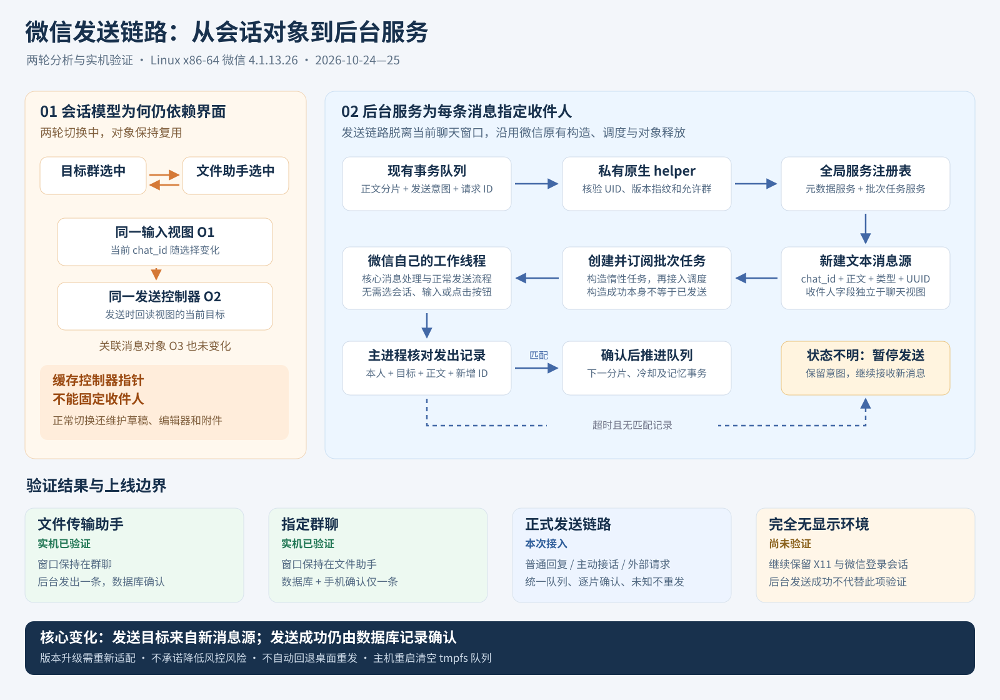

> 历史参考，归档于 2026-10-29。正文保留当时的研究、实验或运维结论；接口、路径、测试数量和状态可能已过时。当前接口以 [wechat_linux 状态](../WECHAT_LINUX.md) 和 [provider 用法](../PROVIDER.md) 为准。

# 两轮微信分析与后台发送

适配样本：Linux x86-64 微信 4.1.13.26。研究结论只针对已核对的固定 ELF。

完整过程、原理与证据边界见 [详细技术报告](WECHAT_RESEARCH_REPORT.md)；也可打开带目录和可放大图示的 离线 HTML 阅读版（历史路径：`docs/WECHAT_RESEARCH_REPORT.html`）。

[PNG 预览](images/native-analysis.png) · [可编辑 SVG](images/native-analysis.svg) · [接口、配置与恢复规则](NATIVE_API.md)

## 第一轮：会话切换时模型如何变化

最初可用入口是聊天输入视图背后的发送控制器。它接收模型对象、发送动作和消息列表，没有独立 chat_id 参数。控制器反向引用输入视图，发送时读取视图当前目标。

实际在目标群和文件传输助手之间切换两轮，输入视图、发送控制器、关联消息对象均保持同一实例；变化的是视图内的目标字符串。因而缓存控制器指针不能固定收件人。正常切换还维护草稿、编辑器和附件，不能只修改目标字符串。

## 第二轮：绕过输入视图的后台服务

全局内核到账号上下文的服务注册表中存在元数据服务和批次任务服务，可以脱离聊天输入视图定位。新建的文本消息源有独立的收件人、正文、类型和 UUID。

批次构造函数返回的是惰性任务，需要订阅后交给微信原有工作线程，不能把构造完成或函数返回当作已发送。调用位置为构造批次 `0x7067550`、订阅 `0x4709f00`、核心处理 `0x64da920`；这些数字是相对模块基址的 RVA，不是跨版本稳定 API。

先在群聊窗口保持不动时向文件传输助手发送，随后保持文件传输助手窗口向目标群发送。两次均获得新增本人发出记录及服务器消息 ID；群测试另由手机确认只收到一条。发送期间已识别的会话切换入口计数均为零。

## 正式接入方式

普通回复与主动回复沿用现有队列，逐片持久化发送意图和独立请求 ID，再将明确收件人及正文交给私有 helper。helper 核验 UID、程序 hash、函数指纹和允许清单，使用新消息对象及原生调度；主进程继续独占数据库确认、游标和记忆事务。

不再选会话、读取输入框或扫描聊天视图。未知提交不重发，旧桌面入口在服务模式下拒绝执行。现有显示环境仍负责微信客户端的登录与运行；本图没有宣称无 X11、跨版本可用、低封号风险或长期稳定性已经验证。

正式发布的提交、离线结果和线上确认由当次发布记录保存，实验单次成功不代替发布验收。
