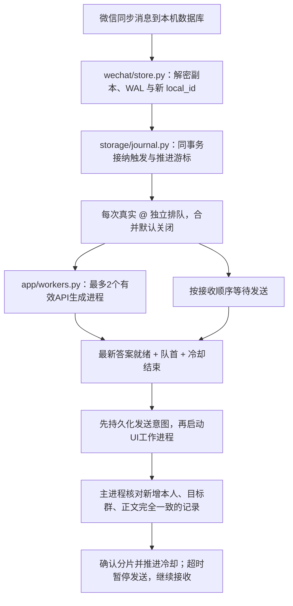

# 完整流程与代码导读

阅读时先沿一次启动走到退出，再沿一条群消息走到回复。正常监听只有一条数据库消息链路；环境检查和界面排障由独立模块提供。

**2026-10-20 本次目录重组仅在 Windows 本地完成，未连接或更新 Linux。** Windows 用于编辑与离线测试，正式运行仍依赖 Linux。配置、人格正文、队列格式和启动命令保持原样。

```text
wxbridge/
  cli.py、__main__.py    命令入口
  config.py             配置与项目根目录定位
  app/                  启动、调度、工作进程、诊断
  ai/                   API、人格/提示词、上下文、图片输入
  wechat/               数据库、解密、消息解析、界面发送
  storage/              事务队列与私有内存目录
```

建议依次阅读 `cli.py → app/runtime.py → app/bot.py`，再按问题进入 `wechat`、`ai` 或 `storage`。逐个文件的地图见 [wxbridge/README.md](../wxbridge/README.md)。

## 一次启动如何走完

| 顺序 | 做什么 | 对应代码与结果 |
| --- | --- | --- |
| 1 | 加载配置和 API 凭据 | `config.py` 固定读取源码根目录 `.env`，合并默认值、JSON、环境变量；提示词等相对路径按配置文件解析 |
| 2 | 准备 Linux 会话 | `start-headless.sh` 启动 Xvfb、D-Bus、AT-SPI、fluxbox 和原生微信，写会话环境文件 |
| 3 | 手机确认登录 | 首次用 `--vnc` 或 `login-vnc.sh` 临时查看界面；登录由用户在手机确认，随后关闭 VNC |
| 4 | 确认数据库可读 | `scan-keys` 调用 `wechat/keyscan.py` 提取并验证当前账号数据库密钥；`check` 确认群、最新消息 ID 和发送组件 |
| 5 | 启动监听 | `cli.py` 分发到 `runtime.run_bot()`；既有 `run-live.py` 也走这里 |
| 6 | 锁定并恢复 | runtime 统一真实 @、600 秒窗口，锁定队列与解密目录；核对账号/群，恢复队列或迁移旧游标；全新队列才跳过历史 |
| 7 | 持续处理与退出 | bot 写状态；退出终止工作进程、保留 SQLite 未完成任务；systemd 停止整个进程组 |

内存挂载、微信安装、账号和系统权限必须先准备好；现有脚本没有把这些步骤封装成自动安装器。当前 Linux 服务是临时服务，重启后不会自动重建这些条件。

## 一条消息如何走到回复



1. `WeChatDeepSeekBot._poll_once()` 按 `local_id` 取新记录，会话时间戳没有跨秒也检查。发送者通过 `real_sender_id → Name2Id` 映射；用联系人确认自己的账号，不能直接取带后缀的目录名。
2. 首次接收时跳过自己、未知发送者、非文本、时间无效、超过 90 秒的触发；XML `atuserlist` 必须精确包含自己的账号 ID。冷却只让已接纳任务等待；排队后不再按 90 秒过期。
3. 每个有效生成版本按触发实际发送时间 `t` 查询 `[t-600, t]`。`build_prompt()` 排除未来、同秒中更大 local_id 及触发 ID；问题另列一次。预算超出时保留失败状态，不悄悄截取历史。合并能力保留但 `queue.debounce_seconds=0` 默认关闭；将来启用时以最后一条触发取窗口并对全部问题去重。
4. `DeepSeekClient.chat()` 默认使用 `deepseek-flash` 和 `thinking: disabled`。API 请求最多尝试三次，只取最终 `content`；模型请求重试与微信发送重试分开。
5. UI 工作进程确认唯一且已选中的群、原生微信窗口、草稿完整读回；优先执行发送按钮 AT-SPI 动作。返回按钮/焦点/草稿长度元数据；主进程单独核对数据库，不能把操作完成当作发出成功。
6. SQLite 在私有 `tmpfs,noswap` 中保存游标、触发、版本、分片与意图，0600；进程重启先确认未决意图，避免重复发送。完成任务清除正文。日志和只读状态只输出元数据。主机重启丢失内存任务。

## 文件职责

| 文件 | 负责什么 |
| --- | --- |
| `cli.py` | 命令解析和分发，不维护另一套监听逻辑 |
| `app/runtime.py` | 启动策略、单实例锁、模拟队列隔离及退出清理 |
| `app/bot.py` | 主进程轮询、生成版本调度、封批、发送确认和实时状态 |
| `storage/journal.py` | SQLite 事务队列、游标、恢复、只读状态和内存路径检查 |
| `app/workers.py` | API/UI 子进程、取消、超时、结果通道与日志隔离 |
| `wechat/store.py` | 数据库读取、群解析、发送者映射、真实 @ 元数据 |
| `ai/context.py` | 发送时间与上下文边界 |
| `wechat/references.py` | 49/57 引用回复、被引用快照及发给模型的显示字段；不获取远程页面或媒体 |
| `ai/images.py` | API 工作进程内只读缓存、图片解密与校验、组装内联图像；不访问数据库或保存明文 |
| `ai/client.py` | HTTP API、请求重试、最终答案提取 |
| `ai/prompts.py`、`prompts/system.md` | 完整读取人格、构造 `build_prompt()`、替换 `{bot_name}`，每次生成读取文件最新内容 |
| `wechat/ui.py` | 发送和界面操作；保留输入测试与无障碍树排障能力 |
| `app/diagnostics.py` | 环境、数据库、UI 检查；正常监听不会调用排障命令 |
| `wechat/messages.py` | 前缀处理、兼容触发和回复分片；runtime 默认强制真实 @ |
| `wechat/crypto.py`、`wechat/keyscan.py`、`storage/memoryfs.py` | SQLCipher 页/WAL、密钥验证、私有内存目录检查 |

SQLCipher 密钥用于读取本机数据库，DeepSeek API Key 用于调用模型，二者用途不同。解密副本可含微信已同步的历史；发送给模型的上下文才限制为十分钟。微信自身的数据仍由其管理。

图片引用还会在主进程通过 `store.image_binding()` 查询本群原消息与附件索引，再由生成进程调用 `images.prepare_multimodal()`。图片不会经过队列写入或进程结果通道；结果只返回安全图片元数据。详见 [图片说明](VISION.md)。

## 检查与测试怎么配合

正常检查用 `env`、`check`，不显示消息正文。`a11y` 是显式界面排障，可能显示正文；`input-test` 会写当前输入框但不点发送。离线测试使用合成数据，不需要运行这些实机命令。

`tests/` 按上下文、数据库、消息流程、启动流程、UI 和内存目录分组。统一入口 `scripts/test-offline.py` 运行 unittest，以及回复分片/提示词和加密/WAL 脚本。

## 本次目录重组的边界

`app` 协调数据库、队列、模型与界面的执行顺序；`ai` 处理模型输入输出；`wechat` 封装当前 Linux 微信的具体适配；`storage` 保存事务状态并检查内存目录。包初始化文件只描述职责，不自动启动组件。

所有微信数据库查询仍由主进程负责；图片生成进程只接收本地文件描述，界面工作进程也不查询数据库。原先放在 API 客户端的 `build_prompt()` 归入 `ai/prompts.py`；`ai/client.py` 专注 HTTP 请求。

`.env`、`config.json`、`prompts/system.md` 的位置不变。提示词模块使用 `config.PROJECT_ROOT` 定位项目根目录，避免包层级变化影响人格路径。已有运维脚本、测试导入和 mock 目标均同步到新路径，未增加旧模块包装层。

源码备份、旧新路径对照与离线验证见 [本次整理记录](../../archives/refactors/20261020-package-layout/README.md)。历史归档保留原版本；后续部署需成套更新新包、脚本及测试，再清理备份过的旧平铺模块。本次没有执行部署。
